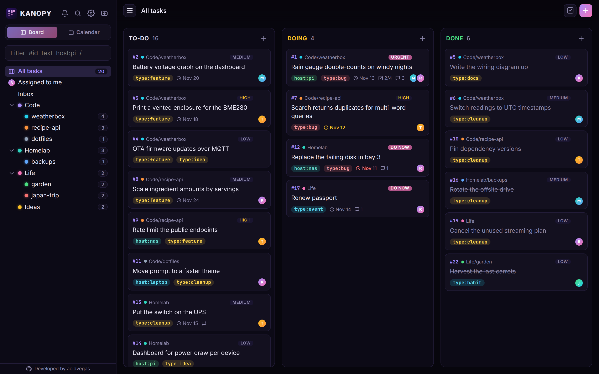
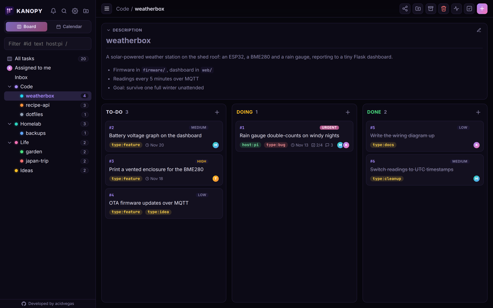
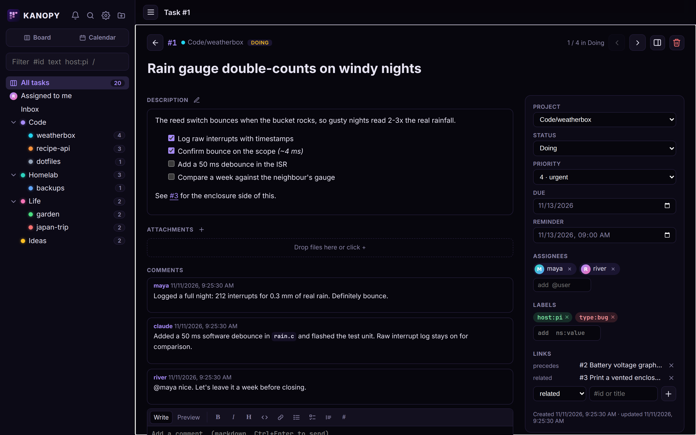
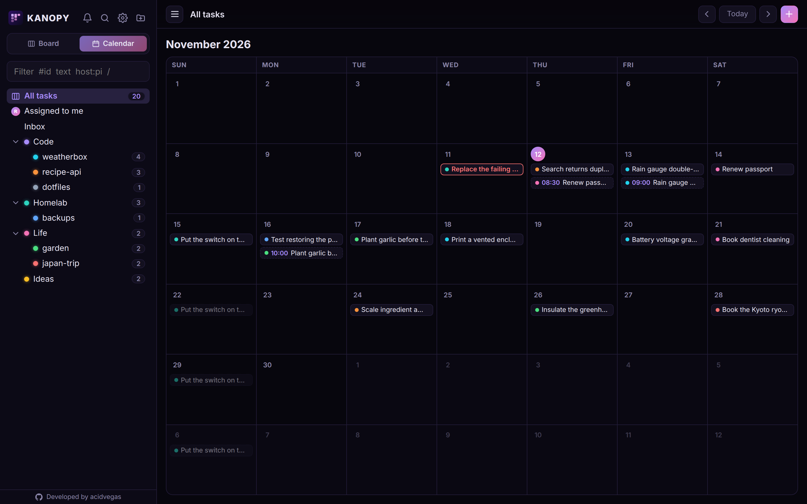
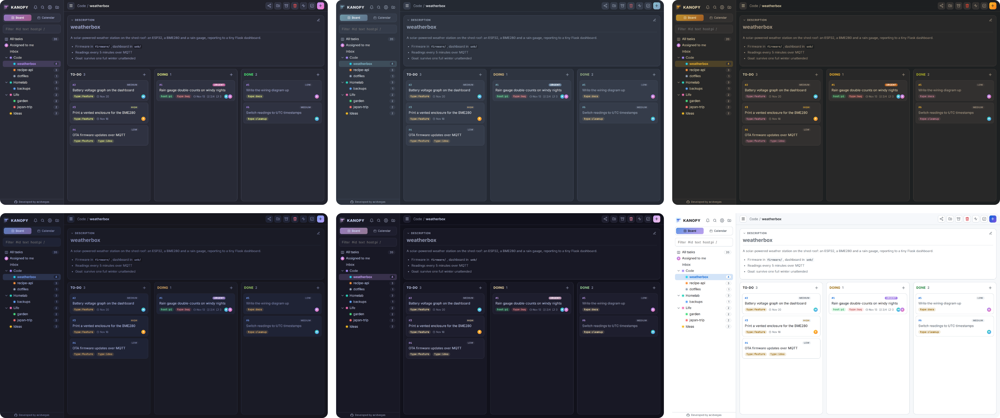

<h1 align="center">kanopy</h1>

<p align="center">A self-hosted kanban board shared by people and their AI agents.</p>

<p align="center">
	<a href="#quick-start">Quick start</a> ·
	<a href="#features">Features</a> ·
	<a href="#connecting-agents">Connecting agents</a> ·
	<a href="#mcp-tools">MCP tools</a> ·
	<a href="#configuration">Configuration</a>
</p>



kanopy keeps your projects, todos and ideas on one board, and lets the agents you work with read and update it the same way you do. Claude Code, opencode or anything else that speaks [MCP](https://modelcontextprotocol.io) can file tasks, move them through To-Do, Doing and Done, leave progress notes and pick up where the last session left off. Every change is logged with who made it, person or agent.

It is a single Python process with a SQLite database and a plain JavaScript frontend. No build step, no external services, nothing to sign up for.

| Project board                    | Task page                  |
|----------------------------------|----------------------------|
|  |  |

| Calendar                           | Themes                         |
|------------------------------------|--------------------------------|
|  |  |

*Screenshots use invented demo data.*

## Quick start

With Docker:

```sh
git clone https://github.com/acidvegas/kanopy && cd kanopy
cp .env.example .env
mkdir -p data
docker compose up -d --build
```

Or with a virtual environment:

```sh
git clone https://github.com/acidvegas/kanopy && cd kanopy
python3 -m venv venv
venv/bin/pip install -r requirements.txt
cp .env.example .env
venv/bin/python -m kanopy.app
```

Open `http://127.0.0.1:8000`. The first page asks you to create the admin account; everyone after that joins through an invite link.

To run it as a service, copy `kanopy.service` to `/etc/systemd/system/`, set `YOUR_USER` and `/path/to/kanopy`, then `sudo systemctl enable --now kanopy`.

## Features

### Board and projects

Projects form a tree addressed by path, like `Code/weatherbox`, and a project's board includes its sub-projects. Cards drag between To-Do, Doing and Done, onto another project in the sidebar, or onto a date in the month calendar. Each project has a markdown description panel and an **activity page** listing every change across it.

Done tasks archive themselves after a configurable number of days, and a bulk mode moves, labels or deletes many tasks at once.

### Tasks

A task carries a markdown description with clickable checklists, a priority, due date, reminder, labels, assignees, file attachments, comments and links to other tasks *(blocks, subtask, related, duplicates, precedes)*. It opens in a side panel or as a full page at `#/task/123`, and `#123` anywhere in text links to it.

Tasks can **repeat** daily, weekly, monthly, yearly, every N days or on chosen weekdays. Marking one done creates the next occurrence with its checklist reset and its dates moved forward; upcoming ones show faded on the calendar.

Every task keeps a **history** of who changed what, including the agent's name for changes made over MCP.

### Search and labels

Search matches every word across titles, descriptions and comments, with filters for project, label, assignee, priority, due date and status. The sidebar filter narrows the board and the project tree as you type *(`#id`, text, `@me`, labels)*.

Labels use a `namespace:value` form. **Global** labels are shared and managed by the admin; a fresh install starts with a set of `type:` labels. Anyone can add **personal** labels for their own use.

### Notifications

Pushes go out through [ntfy](https://ntfy.sh) at reminder time, on the morning a task is due, as a daily overdue digest, and when an agent finishes a task. Mentions, assignments and activity on your tasks also land in an in-app inbox. Each kind can be turned on or off.

### Everything else

- Ten themes, from the purple default to Dracula, Nord, Gruvbox, Catppuccin and GitHub Light
- Works on a phone, including drag and drop
- Markdown editor with a toolbar, preview, shortcuts and `@mention` autocomplete
- Daily database backups to `data/backups`, newest 3 kept

## Accounts and sharing

Everyone signs in with a username and password. The admin creates single-use invite links *(valid 7 days)* on the Settings page.

Projects are private to whoever made them until shared with a user or a team. Sharing a project includes its sub-projects.

| Role    | Can                                      |
|---------|------------------------------------------|
| Viewer  | Read the project and its tasks           |
| Editor  | Create and work on tasks                 |
| Manager | Also edit, archive and share the project |

Anyone can create a team and add members by username. Admins see every project.

## Connecting agents

kanopy serves MCP at `/mcp` *(streamable HTTP, stateless)*. Each agent authenticates with a personal API token from **Settings, API tokens**, acts as that user and sees only what they can. The `X-Agent` header names the agent in comments and history.

Agents get a short set of working rules on connect from `agents/instructions.example.txt`. Copy it to `agents/instructions.txt` *(untracked)* to describe your own project layout.

<details>
<summary><b>Claude Code</b></summary>

Add the server:

```sh
claude mcp add --transport http -s user kanopy http://HOST:PORT/mcp --header "X-Agent: claude" --header "X-Key: $TOKEN"
```

Add `agents/hook.sh` as a `SessionStart` hook in `~/.claude/settings.json`. Each new session then starts with a briefing on the project for the current directory and its open tasks:

```json
{
	"hooks": {
		"SessionStart": [{ "hooks": [{ "type": "command", "command": "/path/to/kanopy/agents/hook.sh" }] }]
	}
}
```

Link the `/task` command, which files a task without a proposal step:

```sh
ln -s /path/to/kanopy/agents/task.md ~/.claude/commands/task.md
```

</details>

<details>
<summary><b>opencode</b></summary>

Save your token to `~/.config/opencode/secrets/kanopy.token` and add the server to `~/.config/opencode/opencode.json`:

```json
{
	"mcp": {
		"kanopy": {
			"type": "remote",
			"url": "http://HOST:PORT/mcp",
			"headers": { "X-Agent": "opencode", "X-Key": "{file:~/.config/opencode/secrets/kanopy.token}" }
		}
	}
}
```

Link the session briefing plugin *(it reads `KANOPY_API`, default `http://127.0.0.1:8000`)* and the `/task` command:

```sh
ln -s /path/to/kanopy/agents/opencode.ts ~/.config/opencode/plugins/kanopy.ts
ln -s /path/to/kanopy/agents/task.md ~/.config/opencode/command/task.md
```

</details>

<details>
<summary><b>Anything else</b></summary>

Any MCP client that supports streamable HTTP works: point it at `http://HOST:PORT/mcp` with the `X-Key` and `X-Agent` headers. For a session briefing without MCP, `GET /api/context?cwd=<dir>` with the `X-Key` header returns plain text for the project whose folder contains `dir`.

</details>

## MCP tools

| Tool            | Does                                                                                                   |
|-----------------|--------------------------------------------------------------------------------------------------------|
| `list_projects` | Project tree with open task counts                                                                     |
| `list_tasks`    | Tasks filtered by project, labels, text, status, priority or due date; `changed` lists recent activity |
| `get_task`      | Full tasks with description, links and comments, or the text of an attachment                          |
| `save_task`     | Create or update any field, set status, tick a checklist item, comment; `ids` updates many at once     |
| `save_project`  | Rename or move, describe, set the local folder, archive                                                |
| `comment`       | Add a progress note                                                                                    |
| `link`          | Relate two tasks, or remove the relation                                                               |
| `labels`        | List labels, create a global `type:` value *(admin)*, delete one                                       |
| `inbox`         | Unread notifications                                                                                   |
| `delete`        | A task, or an empty project                                                                            |

A few rules keep agents from making a mess:

- A new project is created by filing its first task into it, so no project is ever empty
- An agent must read a task before it can replace the description, so it never overwrites edits it has not seen
- `host:` labels that differ only by punctuation *(`host:web01` and `host:web-01`)* are rejected

## Configuration

Settings live in `.env`:

| Variable      | Default     | Purpose                                                                     |
|---------------|-------------|-----------------------------------------------------------------------------|
| `KANOPY_HOST` | `127.0.0.1` | Address to listen on                                                        |
| `KANOPY_PORT` | `8000`      | Port to listen on                                                           |
| `KANOPY_URL`  |             | Public address when behind a reverse proxy                                  |
| `KANOPY_KEY`  |             | Optional; stored as the admin's API token on start, for older agent configs |

Everything else *(ntfy, notification times, timezone, auto-archive)* is set on the Settings page. Data, attachments and backups live in `data/`.

<details>
<summary><b>Running behind a reverse proxy</b></summary>

Keep `KANOPY_HOST=127.0.0.1` and set `KANOPY_URL` to the public address, like `https://kanopy.example.com`. Notification and invite links then use it, the sign-in limit sees the real client address, and the session cookie is marked Secure.

```nginx
server {
	listen 443 ssl;
	server_name kanopy.example.com;
	ssl_certificate     /etc/letsencrypt/live/kanopy.example.com/fullchain.pem;
	ssl_certificate_key /etc/letsencrypt/live/kanopy.example.com/privkey.pem;
	client_max_body_size 100m;

	location / {
		proxy_pass http://127.0.0.1:8000;
		proxy_set_header Host $host;
		proxy_set_header X-Forwarded-For $remote_addr;
		proxy_set_header X-Forwarded-Proto $scheme;
	}
}
```

</details>

## Keyboard shortcuts

| Key   | Action                            |
|-------|-----------------------------------|
| `/`   | Focus the filter                  |
| `n`   | New task                          |
| `Esc` | Close the task, leave select mode |

---

###### Mirrors: [SuperNETs](https://git.supernets.org/acidvegas/) • [GitHub](https://github.com/acidvegas/) • [GitLab](https://gitlab.com/acidvegas/) • [Codeberg](https://codeberg.org/acidvegas/)
